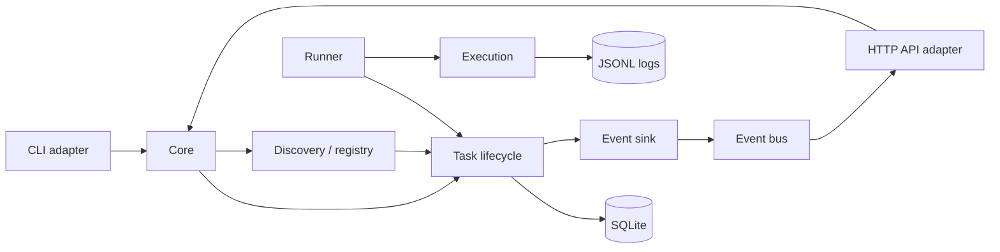
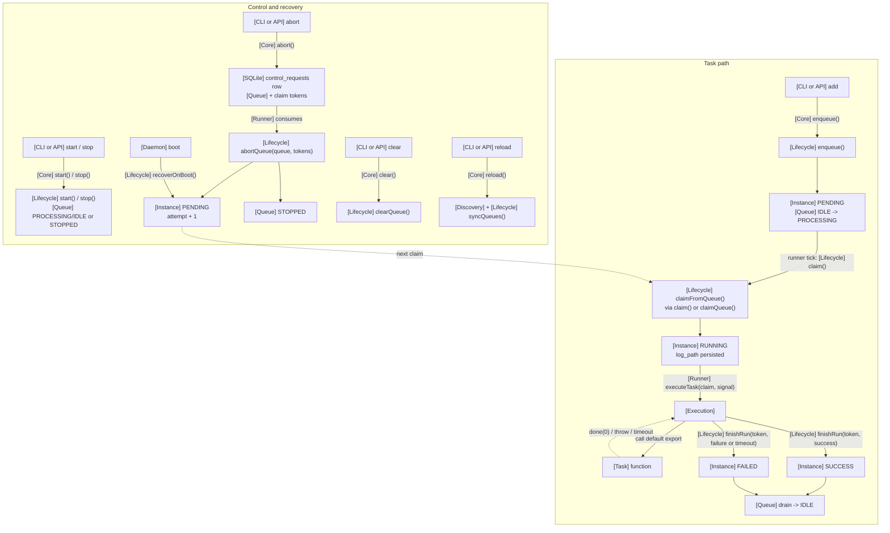

# Design

How the daemon, database, lifecycle, and subcommands fit together. This
document is the design record for the task lifecycle. `docs/SPECS.md` is the
behavioural specification; `GLOSSARY.md` defines the domain terms.

The lifecycle decision is [ADR-0001](adr/0001-task-lifecycle-ownership.md).
The completion fence is [ADR-0002](adr/0002-completion-fence.md). Some parts
are not implemented yet — see [Limitations](#limitations).

## Context

Task instance and queue state is currently written from four places: the
runner marks instances `RUNNING` and returns them to `PENDING`, execution marks
`SUCCESS`/`FAILED` and increments attempts, `queue-state.ts` owns queue
transitions while enqueue, autostart, and drain write queue state directly, and
`control/queue-control.ts` contains a dead second abort implementation.

The concurrency limit is enforced by a read-then-write sequence in the runner,
outside a transaction. The HTTP adapter imports database rows for reads, and
the runner imports the HTTP adapter's event emitter. The lifecycle is shallow:
its interface is a set of row-level updates, its callers do not use it
consistently, and its invariants live at call sites.

The design replaces that with one deep module that owns instance and queue
transitions. The module is transport-independent, persists only state, uses
one transaction per intent, and publishes events after commit.

## Module map



The dependencies point inward. `Lifecycle` imports only the database handle,
its own event types, and `CoreError`. It does not import `cli`, `api`,
`runner`, or `control`.

## Modules and interfaces

### Task lifecycle

`src/core/lifecycle.ts` is the only writer of queue and instance state,
including deletes. It owns both state machines and the coupling between them.

```ts
type QueueState = "IDLE" | "PROCESSING" | "STOPPED";
type InstanceState = "PENDING" | "RUNNING" | "SUCCESS" | "FAILED";

interface ClaimToken {
  instanceId: number;
  attempt: number;
}

interface Claim extends ClaimToken {
  taskId: string;
  entryPoint: string;
  timeoutMs: number;
  input: unknown;
  logPath: string;
}

type RunOutcome =
  | { kind: "success" }
  | { kind: "failure"; exitCode: number; reason?: string }
  | { kind: "timeout" };

interface FinishResult {
  applied: boolean;
  ignored?: "not-running" | "stale-attempt";
}

interface AbortResult {
  // Attempts that were RUNNING before the abort increment.
  cancelled: ClaimToken[];
  queueState: QueueState;
  // True when the request's tokens no longer match a RUNNING instance.
  discarded?: boolean;
}

interface ClearResult {
  deleted: number;
  logPaths: string[];
}

interface Lifecycle {
  enqueue(taskId: string, input: unknown): { id: number; createdAt: string };
  claim(): Claim[];
  claimQueue(queueId: string): Claim[];
  finishRun(token: ClaimToken, outcome: RunOutcome): FinishResult;
  abortQueue(queueId: string, expected?: ClaimToken[]): AbortResult;
  start(queueId: string): QueueState;
  stop(queueId: string): QueueState;
  syncQueues(): { created: number; updated: number };
  recoverOnBoot(): { reset: number; started: number; stayedStopped: number };
  clearQueue(queueId: string, options?: { all?: boolean }): ClearResult;
}

function createLifecycle(config: {
  db: DB;
  events: EventSink;
  logDir: string;
  now?: () => Date;
}): Lifecycle;
```

`claim()` is the runner's normal call: it visits every `PROCESSING` queue in
queue-id order and claims FIFO within each queue. `claimQueue(queueId)` is
the per-queue primitive for tests and future queue-specific scheduling. Both
share one internal `claimFromQueue` helper and the same guarded SQL; neither is
a separate scheduling policy. `claim()` must not call the public
`claimQueue()`, which would open a nested transaction; both call
`claimFromQueue`. If `claimQueue` ever loses its callers, it can be deleted
without changing `claim()`.

`claim()` is a mutating operation, not a query: it atomically marks the
returned instances `RUNNING`. It returns `[]` when nothing is claimable; an
empty result is normal, not an error. `claimQueue(queueId)` returns `[]` when
that queue is not `PROCESSING`, has no pending work, or is at capacity.

`claim()` and `claimQueue()` open an immediate write transaction, compute
the free slots from the running count, select `PENDING` rows in id order, and
mark them `RUNNING` with `started_at` and `log_path`. The caller never reads
state to decide what may run.

`finishRun` takes the token observed at claim. It applies only when the row is
`RUNNING` and its attempt matches the token; otherwise it returns
`{ applied: false }` and writes nothing. This is the fence from ADR-0002.
`success` records exit code 0; `failure` records the supplied exit code and
reason; `timeout` records `FAILED` with reason `timeout`.

`abortQueue` moves the queue's current `RUNNING` instances back to `PENDING`,
increments their attempts, stops the queue, and returns the attempts that were
running so the runner can signal the right controllers. It does not claim or
start work. The optional `expected` tokens are the control request's recorded
tokens: if provided and none matches a currently `RUNNING` instance, the
request is stale, returns `{ cancelled: [], discarded: true }`, and changes
nothing. The core operation is also called `abort`, but it is the two-phase
control-request path; it never calls `abortQueue` itself.

`start` and `stop` are idempotent intent operations. `stop` targets `STOPPED`
from any state. `start` targets `PROCESSING` when there is pending or running
work, and `IDLE` when there is nothing to do. Same-state calls are no-ops.

`enqueue` trusts its input. Input validation stays in core, before the
lifecycle call. `enqueue` ensures the queue exists, inserts the instance, and
moves an `IDLE` queue to `PROCESSING` in the same transaction.

`syncQueues` ensures one queue per task and updates concurrency for existing
queues. It never deletes. Queue retirement is deferred until the historical
instance question is settled.

`recoverOnBoot` resets every `RUNNING` instance to `PENDING`, increments its
attempt, keeps `STOPPED` queues stopped, and autostarts every other queue.

`clearQueue` deletes `SUCCESS` instances by default, or `SUCCESS` and `FAILED`
with `{ all: true }`. `{ all: true }` refuses with `CLEAR_REFUSED_RUNNING` if
any instance is `RUNNING`; the default cannot encounter a running `SUCCESS`
instance. It returns the deleted log paths; the module never touches the
filesystem.

The event contract, in `src/core/events.ts`, is:

```ts
type LifecycleEvent =
  | { type: "instanceStateChanged"; instanceId: number; state: InstanceState }
  | { type: "queueStateChanged"; queueId: string; state: QueueState };

interface EventSink {
  publish(event: LifecycleEvent): void;
}
```

#### Instance state

```text
PENDING ──claim──▶ RUNNING ──exit 0 / return──▶ SUCCESS
                       └──── non-zero / throw / timeout ──▶ FAILED
RUNNING ──abort / recovery──▶ PENDING
                              attempt incremented, partial log kept
```

#### Queue state

```text
IDLE ⇄ PROCESSING
IDLE ──stop──▶ STOPPED
PROCESSING ──stop / abort──▶ STOPPED
STOPPED ──start with work──▶ PROCESSING
STOPPED ──start with no work──▶ IDLE
PROCESSING ──drained──▶ IDLE
```

#### Invariants

- Queue id equals task id. A task definition has exactly one queue.
- `claim` is the only `PENDING → RUNNING` transition and does not increment
  the attempt.
- `abortQueue` and `recoverOnBoot` are the only `RUNNING → PENDING`
  transitions. Both increment the attempt and clear per-attempt result fields.
- `finishRun` applies only to a `RUNNING` row whose attempt matches the claim
  token.
- A `PROCESSING` queue drains to `IDLE` when the last running instance finishes
  and nothing is pending. A `STOPPED` queue never auto-drains.
- Enqueue into `IDLE` starts the queue; enqueue into `STOPPED` leaves it
  stopped; enqueue into `PROCESSING` leaves it processing.
- `claim` repairs an empty `PROCESSING` queue to `IDLE` in the same transaction.
- A `STOPPED` queue stays stopped across a restart.
- The lifecycle touches no filesystem, imports no task module, owns no
  `AbortController`, and enforces no timeout.

#### Transactions and errors

Every intent is one SQLite immediate transaction. Events are collected during
the transaction and published only after commit. A failed transaction publishes
nothing.

Domain errors are `CoreError` from `src/core/errors.ts` with a stable code:

| Code | When |
| --- | --- |
| `TASK_NOT_FOUND` | `enqueue` names an unknown task, or `claim` finds a pending instance whose task row is missing |
| `QUEUE_NOT_FOUND` | `start`, `stop`, `abortQueue`, `clearQueue`, or `claimQueue` names an unknown queue |
| `CLEAR_REFUSED_RUNNING` | `clearQueue({ all: true })` finds a `RUNNING` instance |
| `INVALID_CONCURRENCY` | `syncQueues` reads a non-positive concurrency |

A stale or non-running finish is not an error. It returns
`{ applied: false, ignored: "stale-attempt" | "not-running" }`. The runner's
completion path stays total.

#### What sits behind the seam

The schema and SQL; transaction boundaries and locks; FIFO selection and
concurrency arithmetic; the attempt fence; state legality and idempotence;
timestamp and duration policy; log-path allocation; enqueue/autostart,
abort/stop, finish/drain coupling; boot recovery; and event ordering.

#### Trade-off

The module is deep because the interface is intent-level and the implementation
holds both state machines. The cost is a ten-method surface and a small amount
of ceremony in result types. Splitting queue and instance modules would
recreate the coupling at enqueue and abort, which is exactly the invariant the
module exists to own.

### Core

`src/core/service.ts` exposes `createCore({ db, lifecycle, projectRoot, dataDir })`.
The lifecycle is private to core and the runner; adapters call core operations
only.

Core operations:

- **enqueue and reads** — enqueue, list queues, queue detail, list instances,
  instance detail, read log, list task definitions;
- **queue control** — start, stop, abort, clear;
- **maintenance** — reload discovery, sync queues, boot recovery;
- **install** — lockfile update and package task discovery (CLI-only).

Core validates input before calling `lifecycle.enqueue`. `abort` is
two-phase: core writes a durable control request and waits a bounded time; the
runner performs the lifecycle abort and signals the controllers. Core does not
perform the abort transition itself, so nothing changes when no daemon can
consume the request.

`clear` calls `lifecycle.clearQueue`, then unlinks the returned log paths
best-effort. Reads stay in core over `db/queries`; they are projections, not
state transitions.

### Runner

`createRunner({ db, lifecycle, onReload, pollIntervalMs })` runs one loop:

1. consume pending control requests;
2. for abort requests, call `lifecycle.abortQueue(queueId, request.tokens)`,
   then signal the returned tokens unless the request was discarded;
3. for reload requests, call `onReload`;
4. call `lifecycle.claim()`;
5. launch each claim with an `AbortController` and `executeTask`;
6. `executeTask` calls `lifecycle.finishRun(claim, outcome)` on completion,
   timeout, or throw.

Controllers are keyed by `instanceId:attempt`, never by instance id alone. A
stale abort token therefore cannot signal a newer attempt.

The runner keeps the controller map, timeout timers, task-module import, and
control-request consumption. It does not write queue or instance state.

### Execution

The execution context is:

```ts
interface ExecutionContext<TInput> {
  input: TInput;
  signal: AbortSignal;
  done: (exitCode: number) => void;
}
```

- The default export is the execution contract. `done(0)` succeeds;
  `done(nonZero)` or a throw fails; returning without `done` succeeds.
- Console interception is installed once at daemon start. Each execution runs
  in an `AsyncLocalStorage` scope tagged with `(instanceId, attempt)`, so
  concurrent instances write to the right log and a stale attempt's output can
  be dropped.
- Logs are append-only JSONL, one file per instance. The lifecycle computes
  `instance-<id>.jsonl` and persists `log_path` when it claims the instance.
  Execution creates/appends; it never truncates. A retry preserves the previous
  attempt.
- Timeout completion is committed before the signal fires, so a `done()` from
  an abort handler is a late completion and cannot win.
- Cancellation is cooperative. The runner signals the instance's controller;
  a task that ignores the signal may keep running after its instance returns
  to `PENDING`. The fence discards its late state writes.

### Task registry and discovery

Discovery scans project tasks, user tasks, and installed packages in lockfile
order. It returns definitions and warnings; it does not write the database.

The registry reconciles definitions into the `tasks` table and calls
`lifecycle.syncQueues()` to ensure one queue per task and update concurrency.
Queue retirement for removed tasks is deferred.

### Persistence

The default data directory is `.task-runner/` in the project root:

- `taskrunner.db` — SQLite;
- `logs/` — one JSONL file per task instance;
- `daemon.json` — pid, port, data directory, start time.

SQLite stores task definitions, queues, instances, and control requests. Logs
stay out of SQLite so large output does not grow the database.

| Table | Purpose |
| --- | --- |
| `tasks` | Discovered definitions, including the entrypoint path and schema. |
| `queues` | One row per task id; state and concurrency. |
| `instances` | Enqueued runs; state, attempt, input, timings, exit code, log path. |
| `control_requests` | Durable `abort` and `reload` commands, consumed once by the runner. |

Writes open an immediate transaction so the CLI and daemon cannot both read
the same free-slot count and over-claim.

### Adapters

**CLI.** Every command resolves the project and data directory, opens the
database, constructs the lifecycle and core, calls one core operation, maps
errors, prints output, and closes the database. The CLI never calls the
daemon's HTTP API. Commands that need the live runner check the descriptor pid
and write a control request. Exit codes: 2 for usage, unknown id, or invalid
input; 1 for runtime failure.

**HTTP.** `createApi({ core, events, dataDir })` maps transport input to core
calls, `CoreError.code` to status and JSON error bodies, and core results to
responses. SSE handlers subscribe to the event bus. The API carries no queue
or instance rules. The dashboard is a read-only consumer of the same endpoints
and events; it is not implemented yet.

## Seams and adapters

**Lifecycle seam.** Core and the runner call the intent methods. SQLite is the
implementation, not a repository adapter: a repository port narrow enough to
be honest would leak row writes, and one rich enough to be safe would be the
lifecycle. Tests use a temporary SQLite database with the same schema, so they
cross the same seam as production.

**Event sink seam.** `EventSink.publish(event)` has two real adapters: the
daemon's `createEventBus()` and a recording sink in tests. The lifecycle
publishes after commit, instance event before queue event, and isolates sink
failures so a bad subscriber cannot fail a transition. Within a transaction,
instance events publish in ascending instance-id order, then queue events in
ascending queue-id order; a no-op publishes nothing. `syncQueues` publishes
`IDLE` for created queues; concurrency-only updates publish no event because
the event vocabulary has no concurrency change. Events are notifications, not
truth; a dashboard reads a snapshot and then subscribes.

**Core seam.** The CLI and HTTP API are adapters over the same core
operations. They parse, call, map, and format; they do not own queue rules.

**Execution seam.** The task's default export is the adapter over execution.
The lifecycle hands over a `Claim`; execution owns import, timeout, console
interception, and log append.

**Control-request channel.** The runner reads `control_requests` directly via
`db/queries`. This is the one documented exception to "core owns database
access": the request is a durable cross-process command, not task or queue
state.

**Claim helpers.** `claim()` and `claimQueue()` share one internal helper.
This is deliberate duplication of entry points, not of scheduling rules. The
runner uses `claim()`; tests and future queue-specific callers use
`claimQueue()`.

## Data flow

### Task flow and calls

The normal path is enqueue → claim → execute → finish. Control calls are shown
separately because they can happen before, during, or after a run.



Dotted arrows are returns or re-entry. Abort and recovery return an instance
to `PENDING` with `attempt + 1`; the next claim gets a new token. `core.abort()`
writes the control request and waits; the runner consumes it and calls
`lifecycle.abortQueue()`. `start` and `stop` set the queue's target state,
`clearQueue` deletes finished rows, and `syncQueues` reconciles task
definitions with queues.

### Actor sequence

```mermaid
sequenceDiagram
  autonumber
  participant C as [CLI or HTTP]
  participant K as [Core]
  participant L as [Lifecycle]
  participant D as [SQLite]
  participant S as [EventSink]
  participant R as [Runner]
  participant E as [Execution]

  C->>K: enqueue(task, input)
  K->>L: enqueue
  L->>D: insert [Instance]; [Queue] IDLE -> PROCESSING
  L-->>S: [Instance] PENDING, [Queue] PROCESSING (after commit)
  R->>L: claim()
  L->>L: claimFromQueue(queueId)
  L->>D: [Instance] PENDING -> RUNNING; persist log_path
  L-->>S: [Instance] RUNNING
  R->>E: executeTask(claim, signal)
  E-->>L: finishRun(token, outcome)
  L->>D: [Instance] RUNNING -> SUCCESS/FAILED; [Queue] drain
  L-->>S: [Instance] terminal, [Queue] IDLE
```

Abort is the two-phase path: core writes the request, the runner calls
`lifecycle.abortQueue(queueId, request.tokens)`, the lifecycle commits
`RUNNING → PENDING` and `STOPPED`, and only then does the runner fire the
returned controllers. A request whose tokens no longer match a running attempt
is discarded without changing state.

## Testing

The lifecycle interface is the primary test surface. Tests open a temporary
SQLite database with the production schema, inject a recording `EventSink` and
a fixed clock, and call lifecycle operations directly. They cover FIFO,
concurrency, enqueue autostart, stop/start, abort, drain, recovery, clear, and
the completion fence: finish with an old token after a re-claim and assert
`applied: false`.

Core tests cover validation, reads, control-request handoff, and error codes.
CLI tests run the binary against an isolated data directory and assert output
and exit codes. HTTP tests assert status codes, structured errors, SSE, and log
streaming. A guard test fails if `src/runner/**` or `src/core/**` imports
`src/api/**`.

## Limitations

- The lifecycle extraction, completion fence, core factory, event bus, and
  runner claim loop are not implemented yet.
- Input validation and the CLI context grammar (`@file`, `name=value`,
  `name:=value`, bare-string wrapping, path resolution) are pending.
- Reload does not retire queues for removed tasks.
- The dashboard is a placeholder.
- The CLI repeats project setup in every command until the project-handle
  refactor lands.
- The HTTP health handler reads `daemon.json` directly.
- Events are in-process. A CLI-driven transition publishes into the CLI's sink,
  which the daemon's SSE clients do not see. The daemon sees the resulting
  queue state on its next tick; a live dashboard of CLI transitions needs a
  durable outbox sink.
- `clearQueue` deletes rows but publishes no event; SSE clients may need a
  refresh or a future `queueChanged` event.
- Cooperative cancellation means a task that ignores its signal can outlive
  its instance. State writes are fenced; log bytes from a stale attempt are
  dropped only if execution tags its ALS context with the attempt.
- `claimQueue` is retained as a test and extension surface. If no non-test
  caller appears, it can be deleted without changing `claim()`.

## References

- `docs/SPECS.md` — behavioural specification and implementation decisions.
- `docs/adr/0001-task-lifecycle-ownership.md` — one owner for the lifecycle.
- `docs/adr/0002-completion-fence.md` — why completion carries the attempt.
- `GLOSSARY.md` — task, task instance, queue, task lifecycle, claim, claim
  token, event sink, event bus.
- `tests/README.md` — fixtures and sample-task expectations.
